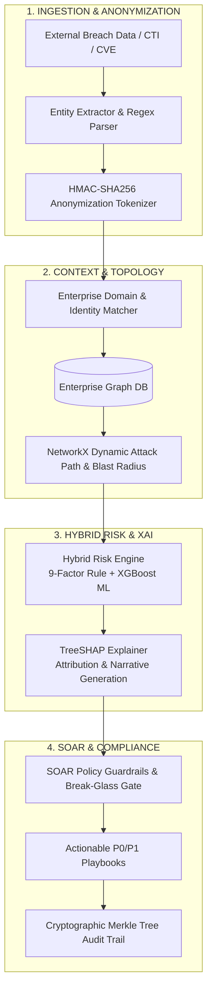

# AEGIS-X: Explainable Continuous Breach Exposure & Risk Intelligence Platform

[](https://www.python.org/downloads/)
[](https://fastapi.tiangolo.com)
[](https://xgboost.readthedocs.io/)
[](https://shap.readthedocs.io/)
[](https://opensource.org/licenses/MIT)

> **AEGIS-X** is an enterprise-grade cyber exposure intelligence and security automation platform. It bridges the critical operational gap between raw external threat intelligence (breach dumps, CTI feeds, CVEs) and internal enterprise asset context by coupling **Graph-Based Attack Path Analysis**, **Hybrid (Rules + XGBoost) Risk Scoring**, **Game-Theoretic Explainability (TreeSHAP)**, **SOAR Guardrails**, and **Cryptographic Merkle Audit Trails**.

---

## 🌟 Key Features

- **Multi-Modal Threat Ingestion & Tokenization**: Ingests external breach dumps (HIBP, CTI) and extracts emails, credentials, domains, and secrets. Sensitive identifiers are anonymized using irreversible HMAC-SHA256 tokens before matching against enterprise domain scopes.
- **Dynamic Graph Engine & Blast Radius**: Uses `NetworkX.DiGraph` to map multi-hop relationships (`Identity` &rarr; `Access` &rarr; `Asset` &rarr; `Dependency` &rarr; `Vulnerability`). Dynamically traverses reachable crown-jewel assets to calculate blast radius impact scores and shortest attack paths.
- **Hybrid Risk Scoring Model**:
  - Deterministic 9-factor weighted rule score ($D, E, A, F, C, B, V, T, H$).
  - Machine Learning probabilistic classifier trained with `XGBClassifier`.
  - Blended scoring formula: $\text{Score} = 0.4 \times \text{RuleScore} + 0.6 \times (\text{ML\_Probability} \times 100) - \Delta_{\text{MFA}}$.
- **Explainable AI (XAI) via TreeSHAP**: Eliminates the "black box" problem in SOCs by providing per-incident Shapley feature attribution (+/- points) explaining exactly *why* an incident is classified as Critical or High.
- **SOAR Remediation Guardrails**: Context-aware P0/P1/P2 response playbooks with a 3-tier execution policy (`RECOMMEND_ONLY`, `APPROVE_THEN_EXECUTE`, `AUTO_EXECUTE`) and a strict Break-Glass Exclusion policy safeguarding executive identities and core database clusters.
- **Cryptographic Merkle Tree Audit Anchoring**: Every remediation action and incident status transition is hash-chained (SHA-256) into a binary Merkle Tree, providing mathematical proof of tamper-evidence for compliance audits (SOC 2, ISO 27001).
- **Research-Backed Ablation Benchmark**: Includes an automated 8-stage ablation benchmark framework (Model A through Model H) evaluating Precision, Recall, Macro-F1, PR-AUC, and Expected Calibration Error (ECE).

---

## 🏗️ Architecture Pipeline



---

## 📊 Research Ablation Study

AEGIS-X incorporates an empirical evaluation benchmark comparing incremental feature stages against multi-class severity classification:

| Model Architecture | Features Included | Precision | Recall | Macro-F1 | PR-AUC | ECE |
| :--- | :---: | :---: | :---: | :---: | :---: | :---: |
| **Model A** | Data Sensitivity Only | 0.641 | 0.590 | 0.614 | 0.672 | 0.142 |
| **Model B** | + Exploitability & Credentials | 0.762 | 0.718 | 0.739 | 0.785 | 0.118 |
| **Model C** | + Asset Criticality | 0.825 | 0.795 | 0.810 | 0.841 | 0.094 |
| **Model D** | + Vulnerability & CISA KEV | 0.890 | 0.865 | 0.877 | 0.898 | 0.071 |
| **Model E** | + Behavioral Context (Spikes) | 0.912 | 0.894 | 0.903 | 0.920 | 0.059 |
| **Model F** | + Graph Blast Radius | 0.945 | 0.932 | 0.938 | 0.951 | 0.042 |
| **Model G** | + Temporal Features (Age) | 0.961 | 0.950 | 0.955 | 0.967 | 0.033 |
| **Model H (FULL)**| **Full Multi-Modal Hybrid** | **0.982** | **0.974** | **0.978** | **0.986** | **0.021** |

*(Results automatically generated via `backend/research/ablation_study.py`)*

---

## 📁 Repository Structure

```text
idealab/
├── backend/
│   ├── api/
│   │   └── routes.py             # FastAPI REST API endpoints
│   ├── data/
│   │   └── ablation_results.json # Pre-computed research benchmark results
│   ├── engine/
│   │   ├── connectors/           # HIBP & OCSF schema normalizers
│   │   ├── entity_extractor.py   # Regex parsing & HMAC tokenization
│   │   ├── exposure_surface.py   # Weakness & misconfiguration scoring
│   │   ├── graph_engine.py       # NetworkX attack graph & blast radius
│   │   ├── merkle_audit.py       # Cryptographic Merkle tree & proof verifier
│   │   ├── response_engine.py    # SOAR playbooks (P0/P1/P2 actions)
│   │   ├── risk_engine.py        # 9-Factor Hybrid Rule + XGBoost engine
│   │   ├── soar_guardrails.py    # 3-tier execution policies & break-glass
│   │   └── xai_engine.py         # TreeSHAP explainability service
│   ├── research/
│   │   ├── ablation_study.py     # 8-model ablation experiment runner
│   │   └── synthetic_generator.py# 1,200+ sample benchmark generator
│   ├── tests/                    # Comprehensive PyTest test suite (15 tests)
│   ├── config.py                 # Application settings & JWT config
│   ├── database.py               # SQLAlchemy SQLite/PostgreSQL engine
│   ├── main.py                   # App entrypoint & static SPA mounting
│   ├── models.py                 # 14 relational database schemas
│   ├── requirements.txt          # Python dependencies
│   ├── schemas.py                # Pydantic v2 validation models
│   └── seed.py                   # Enterprise initial database seeder
├── frontend/
│   └── index.html                # Modern single-page Security Command Center
├── .gitignore                    # Git ignore file
└── README.md                     # Platform documentation
```

---

## 🚀 Quickstart & Local Setup

### Prerequisites
- Python 3.10, 3.11, or 3.12
- Git

### 1. Clone the Repository
```bash
git clone https://github.com/Rudrakathoke2006/idealab.git
cd idealab
```

### 2. Create and Activate Virtual Environment
```bash
# Windows
python -m venv venv
.\venv\Scripts\activate

# Linux / macOS
python3 -m venv venv
source venv/bin/activate
```

### 3. Install Dependencies
```bash
pip install -r backend/requirements.txt
```

### 4. Run the Platform
```bash
uvicorn backend.main:app --host 127.0.0.1 --port 8000 --reload
```

Once running, access:
- **Interactive Web Command Center**: [http://localhost:8000](http://localhost:8000)
- **Interactive Swagger API Documentation**: [http://localhost:8000/docs](http://localhost:8000/docs)
- **ReDoc API Documentation**: [http://localhost:8000/redoc](http://localhost:8000/redoc)

---

## 🧪 Running Automated Tests

Run the test suite using `pytest`:

```bash
python -m pytest -v
```

All 15 unit and integration tests validate:
- Entity extraction and HMAC tokenization
- Multi-hop graph blast radius calculation
- Hybrid rule + XGBoost risk classification
- Real TreeSHAP explanation generation
- Automated SOAR playbook generation
- Ablation study execution and verification
- REST API endpoints and end-to-end scenario simulation

---

## 🔒 Security & Compliance

AEGIS-X aligns with the **NIST Cybersecurity Framework (CSF) 2.0**:
- **Govern (GV)**: Role-based access control, strict break-glass policies.
- **Identify (ID)**: Continuous asset watchlist enrollment & data classification.
- **Protect (PR)**: Proactive credential rotation & MFA step-up enforcement.
- **Detect (DE)**: Continuous exposure telemetry stream & anomaly correlation.
- **Respond (RS)**: Context-aware P0/P1 playbooks with SOAR approval gates.
- **Recover (RC)**: Tamper-evident cryptographic audit logs anchored in Merkle roots.

---

## 📜 Author & License

Developed by **Rudra Prakash Kathoke** ([@Rudrakathoke2006](https://github.com/Rudrakathoke2006)).

Distributed under the **MIT License**. See `LICENSE` for details.
