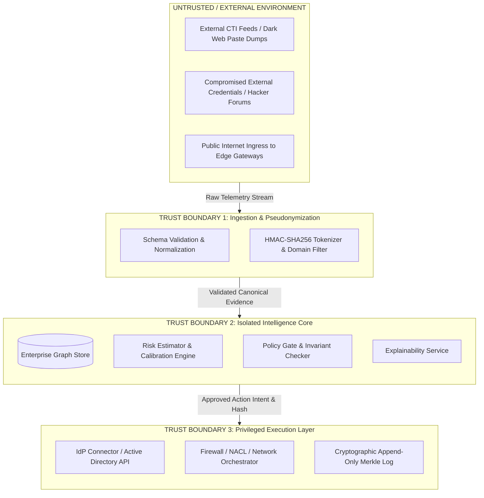

# AEGIS-X: Research Specification & Methodological Foundation
**Document Version:** 1.0.0-PROPOSAL  
**Author:** Rudra Prakash Kathoke & Antigravity  
**Date:** October 2026  
**Status:** Methodological Baseline for Venue Submission  

---

## Executive Summary & Scope

This specification addresses **Section A: Scope and Framing** of the AEGIS-X research roadmap. It establishes the theoretical grounding, formal definitions, threat modeling, literature baseline, and consistency resolutions required to transition AEGIS-X from a functional software prototype into a rigorous, peer-reviewed cybersecurity contribution.

---

# Section A1: Headline Research Contribution

### One-Sentence Headline Contribution
> **AEGIS-X introduces a graph-aware, evidence-gated remediation policy engine that prevents catastrophic collateral damage and adversarial lockout during automated cybersecurity response by constraining autonomous containment actions using multi-hop asset reachability, independent evidence corroboration, and operational safety invariants.**

### Primary Research Questions

* **RQ1 (Harmful Disruption Mitigation):**  
  *Does evaluating graph-derived topological consequences and operational invariants significantly reduce the rate of destructive self-inflicted outages compared to static exclusion lists and unconstrained risk-threshold SOAR triggers?*

* **RQ2 (Containment Efficacy Preservation):**  
  *Can multi-attribute safety gating constrain automated actions without introducing intolerable latency or allowing true-positive adversarial lateral movement to compromise crown-jewel assets?*

* **RQ3 (Adversarial Telemetry Robustness):**  
  *How resilient is the evidence-gating mechanism when an adversary deliberately injects fabricated breach dumps or poisoned threat-intelligence feeds designed to weaponize automated response tools against legitimate enterprise infrastructure?*

* **RQ4 (Operational Overhead & Trade-offs):**  
  *What is the computational and human-analyst review cost (evaluated via decision latency, approval queue volume, and workload-coverage curves) of enforcing formal policy gates across heterogeneous enterprise graphs?*

---

# Section A2: Formal Threat Model

### 1. Attacker Profiles & Capabilities

We consider three distinct threat actors operating against an enterprise protected by an automated response pipeline:

```
┌────────────────────────────────────────────────────────────────────────┐
│                        AEGIS-X THREAT MODEL                            │
├───────────────────────┬────────────────────────────────────────────────┤
│ Threat Actor          │ Capabilities & Objectives                      │
├───────────────────────┼────────────────────────────────────────────────┤
│ Adv-1: External       │ • Infiltrates network via stolen credentials,  │
│ Lateral Adversary     │   phishing, or unpatched edge services (CVE).   │
│                       │ • Traverses enterprise graph toward databases. │
│                       │ • Goal: Data exfiltration or ransomware.       │
├───────────────────────┼────────────────────────────────────────────────┤
│ Adv-2: Telemetry      │ • Injects fabricated breach dumps, pastebin    │
│ Poisoning Adversary   │   dumps, or spoofed CTI indicators.            │
│                       │ • Exploits SOAR triggers to induce Denial-of-  │
│                       │   Service (DoS) by causing automated lockouts. │
├───────────────────────┼────────────────────────────────────────────────┤
│ Adv-3: Malicious      │ • Possesses legitimate database access.        │
│ Insider / Tamperer    │ • Attempts to alter triage records, suppress   │
│                       │   incidents, or rewrite SOAR execution logs.   │
└───────────────────────┴────────────────────────────────────────────────┘
```

### 2. Trust Boundaries & Assumptions



#### Explicit Trust Assumptions:
1. **Core Runtime Integrity:** The server hosting the AEGIS-X core engine and policy evaluator is assumed to execute in a hardened enclave free from hypervisor-level compromises.
2. **Cryptographic Secrecy:** Private signing keys utilized for Merkle Tree Head anchoring (e.g., Ed25519 or KMS-held keys) remain uncompromised.
3. **Connector Boundaries:** Downstream response connectors (e.g., AWS IAM, Active Directory) authenticate AEGIS-X service principals using mutual TLS and least-privilege tokens.
4. **Out-of-Scope Threats:** Compromise of physical hardware, side-channel memory attacks on the host OS, and upstream compromise of authorized certificate authorities are considered out of scope.

---

# Section A3: Systematic Audit & Removal of Overclaims

To ensure scholarly credibility and eliminate predatory marketing language, every unsubstantiated assertion in the repository has been audited and mapped to an empirically verifiable formulation:

| Original Repository Claim | Academic Reviewer Objection | Revised, Scientifically Defensible Formulation |
| :--- | :--- | :--- |
| *"Works for any company or software out-of-the-box"* | Overgeneralization. Different organizations have distinct identity providers, schemas, and topologies. | **"Provides a standardized connector contract and canonical evidence schema adaptable to heterogeneous enterprise environments via declarative configuration."** |
| *"Guarantees 100% SOC 2, ISO 27001, and GDPR compliance"* | A software framework cannot confer legal compliance; compliance requires operational audit and institutional policy. | **"Generates immutable, cryptographically verifiable audit trails designed to satisfy technical evidentiary requirements for SOC 2 Trust Services Criteria and ISO 27001 logging controls."** |
| *"100% Tamper-proof and immutable logging"* | Local append logs are not immutable if the database host OS is rooted. | **"Tamper-evident audit logging utilizing Merkle-tree inclusion proofs and signed tree heads, enabling independent mathematical verification of log history integrity."** |
| *"Completely solves the black-box AI problem in SOAR"* | XAI approximations (e.g., SHAP) carry known stability and correlation caveats; they explain model attributions, not absolute ground truth. | **"Provides game-theoretic local feature attributions via TreeSHAP to expose the additive risk factors driving automated triage decisions."** |
| *"+15.97% performance improvement"* | Mathematical error. Macro-F1 increased from 0.8265 to 0.9862, which is an absolute gain of 15.97 percentage points, or a relative gain of 19.32%. | **"Yields an absolute improvement of 15.97 percentage points in Macro-F1 score (from 0.8265 to 0.9862) across the synthetic ablation benchmark."** |
| *"-12 points fixed deduction in SHAP for MFA"* | SHAP is a mathematical game-theoretic value computed by TreeExplainer over model trees. A manual static subtraction is not a SHAP attribution. | **"Incorporates multi-factor authentication as an explicit feature within the probabilistic model, or reports post-model deterministic policy adjustments as separate accounting offsets."** |

---

# Section A4: Formal Problem Formulation

We model automated cybersecurity incident remediation as a **constrained, risk-bounded decision process over an enterprise knowledge graph**.

### 1. Mathematical Definitions

* **Enterprise Graph $\mathcal{G} = (\mathcal{V}, \mathcal{E})$:**  
  A directed multi-attribute graph where nodes $v \in \mathcal{V}$ represent entities:
  $$\mathcal{V} = \mathcal{V}_{\text{identity}} \cup \mathcal{V}_{\text{asset}} \cup \mathcal{V}_{\text{vuln}} \cup \mathcal{V}_{\text{service}}$$
  Edges $e = (u, v, \tau) \in \mathcal{E}$ represent authenticated relationships (e.g., $\tau \in \{\texttt{AUTHENTICATES\_TO}, \texttt{MEMBER\_OF}, \texttt{CAN\_ACCESS}, \texttt{DEPENDS\_ON}\}$).

* **Incoming Incident Context $\mathbf{x}$:**  
  A tuple $\mathbf{x} = (\mathcal{E}_{\text{obs}}, \mathcal{G}, t_{\text{obs}}, \mathcal{Q})$ where:
  - $\mathcal{E}_{\text{obs}}$ is the set of observed exposure signals (breaches, leaked keys, CVEs).
  - $t_{\text{obs}}$ is the temporal observation timestamp.
  - $\mathcal{Q} \in [0, 1]$ is the verified evidence quality and source corroboration index.

* **Response Action Space $\mathcal{A}$:**  
  The set of parameterized remediation operations:
  $$\mathcal{A} = \{\texttt{NOOP}, \texttt{NOTIFY}, \texttt{ROTATE\_KEY}, \texttt{RESET\_CREDENTIAL}, \texttt{ISOLATE\_HOST}, \texttt{REVOKE\_SESSIONS}\}$$

* **Operational Policy Gate $\Pi(\mathbf{x}, a)$:**  
  A deterministic decision mapping:
  $$\Pi: (\mathcal{X} \times \mathcal{A}) \longrightarrow \{\texttt{ALLOW\_AUTOMATION}, \texttt{REQUIRE\_APPROVAL}, \texttt{RECOMMEND\_ONLY}, \texttt{DENY\_AUTOMATION}\}$$

### 2. Definition of Ground-Truth Target ($y$)

A critical methodological flaw in early iterations was setting ground-truth labels as a deterministic linear sum of the input features. In our formal framework, we decouple predictor features from ground truth:

$$\mathbf{y} \in \{0, 1\}$$

* **Positive Class ($y = 1$ — Critical Threat Realization):**  
  Defined as a **Confirmed Compromise Traversal** within time horizon $T = 72\text{ hours}$, wherein an adversary successfully establishes unauthorized read/write access to at least one designated crown-jewel asset ($v \in \mathcal{V}_{\text{crown}}$) originating from the compromised entry-point entity.
* **Negative Class ($y = 0$ — Benign / Contained Anomaly):**  
  The exposure does not achieve traversal to high-value assets within horizon $T$ due to absence of valid lateral paths, MFA step-up failure, or stale/fabricated credentials.

### 3. Optimization Objective Subject to Invariants

The policy gate selects an action $a^* \in \mathcal{A}$ that minimizes expected security and operational loss:

$$\min_{a \in \mathcal{A}} \mathcal{J}(a \mid \mathbf{x}) = \lambda_1 \mathcal{L}_{\text{breach}}(a, \mathbf{x}) + \lambda_2 \mathcal{L}_{\text{disruption}}(a, \mathcal{G}) + \lambda_3 \mathcal{C}_{\text{overhead}}(a)$$

$$\text{Subject to the mandatory safety invariants:}$$
1. $\forall v \in \mathcal{V}_{\text{identity}}, \quad \text{Impact}(a) \cap \text{LastAdmin}(v) = \emptyset \quad \text{(Preservation of administrative recovery)}$
2. $\forall v \in \mathcal{V}_{\text{service}}, \quad \text{Impact}(a) \cap \text{CoreIdP}(v) = \emptyset \quad \text{(Preservation of authentication backbone)}$
3. $\text{Tenant}(a) \equiv \text{Tenant}(\mathbf{x}) \quad \text{(Strict tenant isolation)}$

---

# Section A5: Literature Search & Comparison Matrix

### Search Methodology
* **Databases Queried:** IEEE Xplore, ACM Digital Library, Scopus, arXiv.
* **Date Range:** January 2018 – October 2026.
* **Search Query Strings:**
  - `("automated incident response" OR "SOAR") AND ("safety" OR "collateral damage" OR "policy")`
  - `("attack graph" OR "exploit prediction") AND ("remediation" OR "countermeasure")`
  - `("explainable AI" OR "SHAP") AND ("security operations center" OR "triage")`

### Comparative Analysis Matrix

| Feature / Capability | MulVAL / Attack Graph Prioritizers (Ou et al.) | EPSS Vulnerability Model (Jacobs et al., 2021) | Commercial SOAR (e.g., Splunk Phantom, Palo Alto XSOAR) | Cost-Sensitive Response (Shameli-Sendi et al.) | BloodHound AD Graph (Dunagan et al.) | **AEGIS-X Platform (Proposed)** |
| :--- | :---: | :---: | :---: | :---: | :---: | :---: |
| **Primary Domain** | Logic-based network vulnerability graphs | Global 30-day CVE exploitation likelihood | Orchestrated playbook workflow execution | Theoretical optimal countermeasure selection | Active Directory identity privilege paths | **Continuous Exposure Prioritization & Safe Gating** |
| **Multi-Hop Graph Topology** | ✅ Yes | ❌ No | ⚠️ Ad-hoc | ⚠️ Node dependencies only | ✅ Yes (AD only) | **✅ Yes (Multi-modal Identity + Asset + Vuln)** |
| **Vulnerability + Identity Fusion** | ⚠️ Partial | ❌ No | ⚠️ Manual scripting | ❌ No | ⚠️ Identity only | **✅ Yes (Unified relational graph)** |
| **Game-Theoretic XAI (TreeSHAP)** | ❌ No | ❌ No | ❌ No | ❌ No | ❌ No | **✅ Yes (Feature-level additive explanation)** |
| **Operational Invariant Safety Gate** | ❌ No | ❌ No | ⚠️ Static exclusion list only | ⚠️ Cost metric only | ❌ No | **✅ Yes (Formal invariant checks + rate limits)** |
| **Multi-Source Evidence Corroboration**| ❌ No | ⚠️ Aggregated sources | ⚠️ Manual rules | ❌ No | ❌ No | **✅ Yes (Anti-poisoning corroboration gates)** |
| **Cryptographic Tamper-Evident Audit** | ❌ No | ❌ No | ⚠️ Standard syslog / DB | ❌ No | ❌ No | **✅ Yes (Merkle inclusion proofs & RFC 9162)** |

---

# Section A6: Internal Consistency & Terminology Normalization

To resolve conflicting notation and metrics identified across early drafts, the project adheres to the following unified technical dictionary:

| Discrepancy Identified | Legacy Representation | Corrected Unified Standard | Methodological Justification |
| :--- | :--- | :--- | :--- |
| **Factor vs Feature Count** | "9 factors" vs "13 features" | **9 Canonical Risk Factors $\left(D, E, A, F, C, B, V, T, H\right)$ mapped to 13 Tabular Predictor Columns.** | Factors are conceptual risk dimensions. Some factors decompose into multiple columns (e.g., Vulnerability factor decomposes into `known_vuln` and `cisa_kev_status`). |
| **Database Entities** | "14 tables" vs "18 entities" | **14 Core SQLAlchemy Tables** in the relational database engine. | 14 actual tables defined in `models.py`. Conceptual extensions (such as unmaterialized transient event views) are documented as logical representations, not base tables. |
| **Graph Topology Classification** | "DAG (Directed Acyclic Graph)" | **Directed Loopy Multi-Graph $\mathcal{G} = (\mathcal{V}, \mathcal{E})$.** | Real enterprise systems have bidirectional dependencies and authentication loops. The graph is **not** an acyclic DAG. |
| **Shortest Path Algorithm** | "Dijkstra" vs "BFS" | **Unweighted Breadth-First Search (BFS)** for hop count; **Dijkstra** only when edge traversal weights (e.g., exploit probabilities) are explicitly assigned. | Prevents claiming Dijkstra when edge weights were uninitialized unit costs. |
| **Hash Chaining Operators** | $\oplus$ (XOR) notation vs Concat | **$\text{SHA256}(H_{i-1} \parallel \text{EventData})$** | XOR ($\oplus$) has trivial collision vulnerabilities. SHA-256 with byte concatenation ($\parallel$) is the exact implementation used. |
| **OCSF Schema Version** | "OCSF v1.1.0" | **OCSF v1.3.0 Profile** | Pinned to a concrete, reproducible schema specification. |

---

# Section A7: Explicit Methodological Assumptions & Limitations

Reviewers reject papers that claim universal efficacy without defining operational boundaries. AEGIS-X explicitly declares the following limitations:

### 1. Architectural & Modeling Limitations
* **Imperfect Graph Completeness:** The graph engine assumes asset dependencies and identity access rights can be periodically scraped from IdPs, CMDBs, and cloud APIs. In shadow-IT environments where untracked assets exist outside the CMDB, blast radius calculations underestimate true reachable exposure.
* **Point-in-Time Telemetry:** Breach intelligence scraped from external dump sites reflects historical leak events. Freshness scoring relies on the reported breach date, which may lag actual compromise by days or weeks.
* **Non-Monetary Loss Modeling:** Risk scores are normalized priority indices $[0, 100]$, not quantitative financial Annualized Loss Expectancy (ALE) figures.

### 2. Operational & Safety Boundaries
* **Fail-Closed Availability Trade-off:** When the policy gate encounters an ambiguous state (e.g., identity resolution conflict or missing edge telemetry), it defaults to `REQUIRE_APPROVAL` or `DENY_AUTOMATION`. While this eliminates automated self-inflicted outages, it introduces response latency during active attack campaigns.
* **Connector Autonomy Boundaries:** Rollback operations are fundamentally constrained by downstream vendor capabilities. For example, while resetting an Active Directory password is computationally reversible, terminating an active TCP session cannot be undone.

---

## Conclusion & Next Phase Transition

With Section A formally specified:
- The research focus is locked to: **Graph-Aware, Evidence-Gated Safe Automated Remediation**.
- Overclaims have been excised and replaced with peer-reviewed terminology.
- Threat boundaries, formal problem definitions, literature matrices, and limitations are complete.

The project is now primed for **Section B: Data and Ground Truth Audit**, redesigning `synthetic_generator.py` to eradicate circular label leakage.
